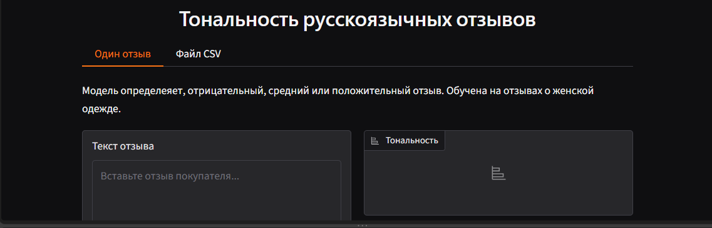

# Тональность русскоязычных отзывов

Приложение определяет, положительный, средний или отрицательный отзыв покупателя,
и умеет обрабатывать целые файлы CSV со сводкой и графиком.



## Зачем

Владельцы магазинов и кафе вручную читают сотни отзывов. Проект автоматизирует первичный разбор:
видно, какая доля отзывов жалуется, а какая хвалит, и какие отзывы стоит прочитать первыми.

## Данные

- Датасет `mteb/RuReviewsClassification` (отзывы на женскую одежду и аксессуары).
- 45 000 отзывов для обучения, 15 000 для валидации, 2048 для теста; классы сбалансированы.
- Метки получены автоматически по оценке покупателя, поэтому содержат шум.

## Модели и результаты

- **Baseline:** TF-IDF + логистическая регрессия.
- **Основная модель:** `cointegrated/rubert-tiny2`, дообученная 3 эпохи (около 5 минут на GPU).

| | Baseline | rubert-tiny2 |
|---|---|---|
| validation, accuracy / macro F1 | 0.74 / 0.74 | 0.76 / 0.76 |
| test, accuracy / macro F1 | 0.75 / 0.75 | 0.77 / 0.77 |

F1 по классам на тесте (rubert-tiny2): отрицательные 0.74, средние 0.67, положительные 0.89.

Тест запускался один раз, модель под него не подгонялась. Нейросеть лучше baseline примерно на 1–2 пункта
по всем классам; на тесте такая разница сопоставима со случайным разбросом, поэтому важно, что направление
стабильно на обеих выборках.

## Анализ ошибок

- Отрицательный отзыв почти не путается с положительным (около 1% ошибок), основная путаница идёт между соседними классами.
- Класс «средний» самый трудный из-за смешанных отзывов и шума в метках.
- Слабое место: вежливые жалобы без эмоциональных слов (например, на размер), а также конструкции с отрицанием.

## Запуск

```
git clone https://github.com/sulamifl/analyze_feedbacks.git
cd analyze_feedbacks
python -m venv venv
venv\Scripts\activate
pip install -r requirements.txt
python app.py
```

Модель скачивается автоматически с Hugging Face: https://huggingface.co/edelweiss1/rubert-tiny2-ru-reviews-sentiment.
Первый запуск может занять несколько минут. В приложении две вкладки: один отзыв и загрузка CSV (колонка с текстом
указывается в интерфейсе, по умолчанию `text`).

## Ограничения

- Модель обучена на отзывах об одежде; на отзывах о кафе, салонах и других сферах качество не проверялось.
- Автоматические метки задают потолок качества; часть «ошибок» модели на самом деле спорные метки.
- Класс «средний» определяется хуже остальных.
- Это учебный проект, он не заменяет чтение отзывов, а помогает расставить приоритеты.

## Структура

- `app.py` — приложение на Gradio
- `notebooks/` — baseline, обучение и разбор ошибок
- `requirements.txt` — зависимости